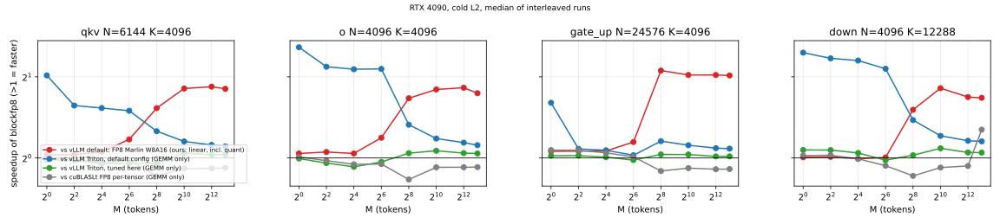

# blockfp8

A block-scaled FP8 GEMM for NVIDIA Ada GPUs (sm_89, measured on an RTX 4090),
written with CuTe from CUTLASS v4.8.1, for FP8 LLM checkpoints such as
Qwen3-8B-FP8.

**Problem.** DeepSeek-V3-style FP8 checkpoints store weights as e4m3 with one
scale per 128x128 block and quantize activations per token in 1x128 groups.
vLLM 0.31 has no FP8 tensor-core kernel for this format on Ada: its CUTLASS
block-FP8 kernel is Hopper/Blackwell only
(`cutlass_scaled_mm_supports_block_fp8(89)` is False), and what it actually
selects on this GPU is `MarlinFP8ScaledMMLinearKernel`, a weight-only kernel
that dequantizes the FP8 weights to bf16 and runs bf16 MMAs (W8A16). That was
established by asking vLLM's own selector (`init_fp8_linear_kernel`, called in
`bench/vllm_baselines.py`; the answer is recorded in
`results/gemm/qwen3_8b.json`). Its Triton W8A8 block kernel is next in line
and only runs if Marlin is disabled.

**Approach.** `mma.sync.m16n8k32` e4m3 with FP32 accumulation; cp.async
multi-stage pipeline into swizzled shared memory; ldmatrix; two-level
accumulation (MMA partials per 128-wide K block, promoted with that block's
scales on the CUDA cores); narrow tiles and deterministic split-K for small
batches; a per-shape plan table from an autotuning sweep.
Details: [docs/design.md](docs/design.md),
[docs/design-tradeoffs.md](docs/design-tradeoffs.md).

**Results** (Qwen3-8B layer shapes, cold L2, median of 10 interleaved runs,
kernel spans from CUPTI; full tables in
[results/gemm/summary.md](results/gemm/summary.md)):

| | M = 1-16 (decode) | M = 64-256 | M = 1024-8192 (prefill) |
|---|---|---|---|
| this kernel | 746-926 GB/s of weights (DRAM read peak 957) | 79-296 TFLOPS | 293-320 TFLOPS (MMA peak 367 at 2.8 GHz) |
| vs vLLM's default here, FP8 Marlin W8A16 (ours incl. activation quantization) | 0.90-1.04x: **loses up to 10%** except on gate_up | 0.91-2.09x | **1.64-2.01x faster** |
| vs vLLM Triton block-FP8, shipped default config | 1.05-2.46x faster | 0.99-1.96x | 1.09-1.18x faster |
| vs the same Triton kernel tuned for this GPU | 0.91-1.06x | **0.79-1.01x: loses up to 21%** | 1.01-1.06x faster |
| vs cuBLASLt FP8, one scale per tensor (coarser scaling) | 0.90-1.03x | **0.70-0.95x: loses** | 0.88-1.07x: loses up to 12% on most shapes |

Ratios are baseline time / our time; all GEMM-only except the Marlin row.



Accuracy equals vLLM's Triton kernel (same instruction, same promotion
interval): relative Frobenius error 1.668e-3 for both on the down
projection at M = 8192 (first 256 rows), dominated by bf16 output rounding. The FP8 MMA keeps
13 bits below the largest addend and truncates the rest
([results/micro](results/micro)); promoting every 128-wide block keeps the
accumulation error about 28x below bf16 rounding.

**Limitations.**
- Mid-size batches (M = 64-256) lose to tuned Triton and to cuBLASLt: all
  compiled tiles are 128 columns wide, so these shapes get too few CTAs or
  re-read weights; a 64-column tile or stream-K is the missing piece.
- Decode loses to Marlin by up to 10% once the separate activation
  quantization kernel (vLLM's, about 3 us) is counted; fusing the
  quantization is the next step.
- Not yet integrated into vLLM; no end-to-end numbers.
- One GPU (RTX 4090, clocks not lockable, median SM clock 2.79 GHz during
  the runs), shapes of one model; the plan table is specific to both.
- N must be a multiple of 8 and K of 16; split-K counters assume calls on
  one CUDA stream per device at a time.

## Build and test

```
git submodule update --init --depth 1
uv venv .venv --python 3.12 && uv pip install --python .venv/bin/python vllm==0.31.0 pytest matplotlib
cmake -S . -B build -G Ninja -DPython3_EXECUTABLE=$PWD/.venv/bin/python && cmake --build build
.venv/bin/python -m pytest tests          # GPU tests skip without a GPU or the build
```

Benchmarks hold the machine-wide GPU lock: `flock /var/tmp/rtx4090.lock
.venv/bin/python bench/bench_gemm.py` (also `bench/micro/run_micro.py`,
`bench/autotune.py`, `bench/tune_triton.py`); `bench/report.py` regenerates
the summary and the chart.

## Layout

- `blockfp8/`: Python API (`quantize_activations`, `gemm`), layouts, FP64
  reference and error bound
- `csrc/`: the CuTe kernel, configurations and plan table, PyTorch op
- `bench/micro/`: MMA peak, memory bandwidth, MMA precision
- `bench/`: GEMM benchmark, autotuning, Triton tuning, vLLM baselines
- `results/`: raw results with GPU state and commit
